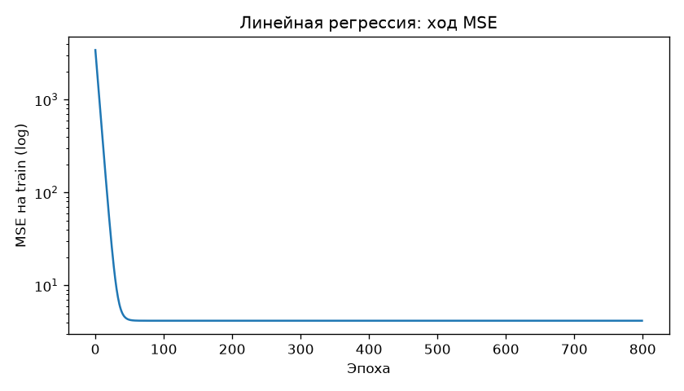
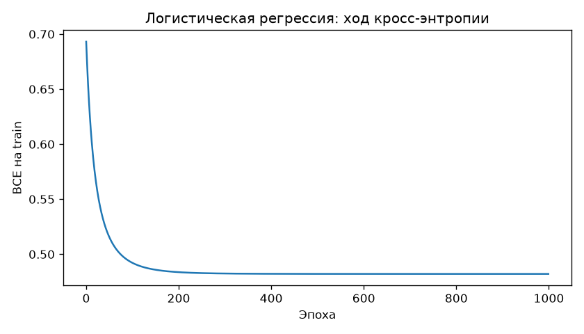
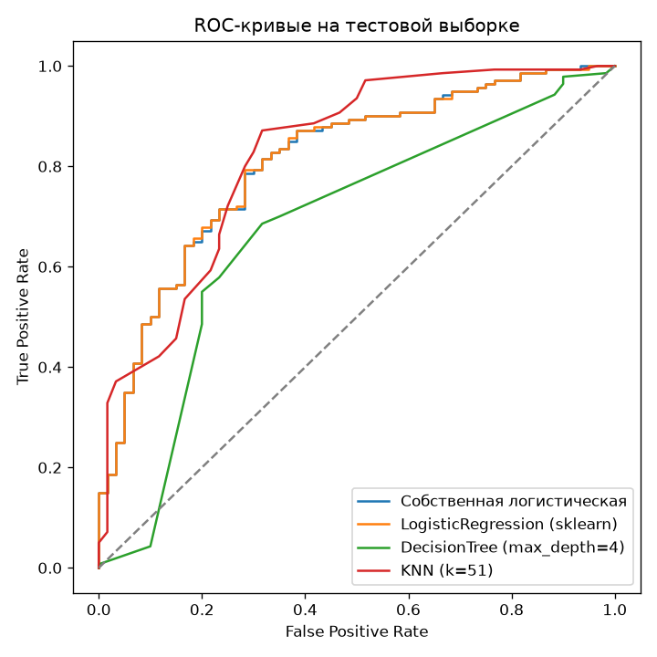

# Отчёт по лабораторной №3: линейные модели

Обе модели реализованы в `linear_models.py` на NumPy с пакетным градиентным спуском: на каждой эпохе градиент считается по всей обучающей выборке. Готовые `LinearRegression` и `LogisticRegression` внутри собственных моделей не используются. Готовая `LogisticRegression` из sklearn участвует только в сравнении в части 3.

## Данные и подготовка

### Student_Performance.csv (регрессия)

- 10 000 строк, 5 признаков, целевая переменная — `Performance Index`. Пропусков нет.
- `Extracurricular Activities` переведён в число: `Yes` → 1, `No` → 0 (4948 и 5052 строк).
- Разбиение `train_test_split(test_size=0.2, random_state=42)`: 8000 строк для обучения, 2000 для теста.

### german.csv (классификация)

- 1000 строк, 20 признаков, разделитель `;`. Целевая переменная — первый столбец `Creditability`: 700 «хороших» клиентов (1) и 300 «плохих» (0). Пропусков нет.
- Признаки в файле уже закодированы целыми числами. В основном эксперименте они используются как есть.
- Разбиение `train_test_split(test_size=0.2, random_state=42, stratify=Creditability)`: 800 строк для обучения, 200 для теста, в тесте 140 клиентов класса 1 и 60 класса 0. Все модели части 3 обучаются и оцениваются на этом же разбиении.

### Масштабирование

Признаки идут в разных масштабах: в Student_Performance `Previous Scores` лежит в диапазоне 40–99, а бинарный признак — в {0, 1}; в german `Credit_Amount` доходит до ~18 000. На таких данных градиентный спуск с одним шагом обучения либо расходится, либо очень медленно сходится по мелким признакам. Поэтому каждая модель стандартизирует признаки внутри себя, по среднему и стандартному отклонению **только обучающей части** (тест в статистики не попадает).

После обучения веса пересчитываются в исходный масштаб признаков (`w / std`, `b − Σ w·mean / std`). Благодаря этому возвращаемые `weights` и `bias` можно применять к исходным данным напрямую, без отдельного скейлера.

## Гипотезы и эксперименты

### Параметры обучения

| Модель | learning_rate | epochs | Функция потерь |
|---|---|---|---|
| Линейная регрессия | 0.05 | 800 | MSE, градиент `2/n · Xᵀ(Xw + b − y)` |
| Логистическая регрессия | 0.1 | 1000 | бинарная кросс-энтропия, градиент `1/n · Xᵀ(σ(Xw + b) − y)` |

Веса инициализируются нулями. Порог классификации — 0.5.

### Ход MSE (линейная регрессия)

| Эпоха | 0 | 10 | 50 | 100 | 200 | 400 | 799 |
|---|---|---|---|---|---|---|---|
| MSE на train | 3428.04 | 421.08 | 4.26 | 4.1697 | 4.1697 | 4.1697 | 4.1697 |



Начальная MSE большая, потому что модель стартует с нулевых весов и предсказывает 0 при среднем значении цели ≈55. К 50-й эпохе ошибка падает почти до минимума, к 100-й выходит на плато 4.1697. Для проверки модель сравнивалась с точным решением методом наименьших квадратов (`sklearn.linear_model.LinearRegression`, только как эталон): веса, смещение и тестовая MSE совпали до 4-го знака.

**Гипотеза 1: шаг обучения влияет на сходимость, а не на итоговое качество, если модель успевает сойтись.**

| learning_rate | MSE на train (последняя эпоха) | MSE на test |
|---|---|---|
| 0.001 | 144.17 | 141.12 |
| 0.01 | 4.1697 | 4.0826 |
| 0.05 | 4.1697 | 4.0826 |
| 0.1 | 4.1697 | 4.0826 |

При шаге 0.001 модель за 800 эпох не сходится. При шаге от 0.01 и выше результат одинаковый: задача выпуклая, и все такие запуски приходят к одному оптимуму. Гипотеза подтвердилась.

Итоговые веса в исходном масштабе: `Hours Studied` 2.8525, `Previous Scores` 1.0170, `Extracurricular Activities` 0.6086, `Sleep Hours` 0.4769, `Sample Question Papers Practiced` 0.1918, смещение −33.9219. Например, каждый дополнительный час занятий добавляет к индексу ≈2.85 балла.

### Ход кросс-энтропии (логистическая регрессия)

BCE на train снижается с 0.6931 (это ln 2, то есть p = 0.5 при нулевых весах) до 0.4821. На последних эпохах изменение за эпоху ~1.6·10⁻⁹, то есть модель сошлась. Увеличение числа эпох до 5000 и 20 000 метрики не меняет.



**Гипотеза 2: собственная модель после сходимости совпадает с готовой.** ROC-AUC у собственной модели 0.8081, у sklearn `LogisticRegression` 0.8086, остальные метрики совпадают полностью. Небольшая разница в ROC-AUC объясняется L2-регуляризацией (C = 1) в версии sklearn. Гипотеза подтвердилась.

**Гипотеза 3: шаг обучения.**

| learning_rate | BCE на train | ROC-AUC на test |
|---|---|---|
| 0.01 | 0.4923 | 0.8246 |
| 0.1 | 0.4821 | 0.8081 |
| 0.5 | 0.4821 | 0.8081 |

При шаге 0.01 модель за 1000 эпох не досходится, но на тесте ROC-AUC у неё выше. Это эффект ранней остановки: она работает как регуляризация и не даёт весам подстроиться под шум 800 обучающих примеров. Итоговым параметром оставлен шаг 0.1 по умолчанию из контракта, потому что выбирать параметры по тестовой выборке нельзя.

**Гипотеза 4: one-hot кодирование категориальных признаков german улучшит линейную модель.** Признаки вроде `Purpose` и `Account_Balance` — номера категорий, а не величины. Линейная модель вынуждена считать их влияние монотонным по номеру. После one-hot кодирования 11 категориальных столбцов (`drop_first=True`) собственная модель показала ROC-AUC 0.8255 (было 0.8081), Accuracy 0.795 (было 0.770), F1 0.8591 (было 0.8446). Гипотеза подтвердилась. Для сравнения в части 3 используются исходные признаки, чтобы все модели работали на одинаковых данных. Включить one-hot можно параметром `load_german_classification_input(one_hot=True)`.

### Подбор параметров базовых моделей

Гиперпараметры дерева и KNN подбирались 5-кратной стратифицированной кросс-валидацией **только на обучающей части**, метрика — ROC-AUC.

| max_depth дерева | 2 | 3 | **4** | 5 | 6 | 8 | None |
|---|---|---|---|---|---|---|---|
| CV ROC-AUC | 0.6892 | 0.6980 | **0.7085** | 0.6942 | 0.6938 | 0.6537 | 0.6304 |

| k соседей (KNN со стандартизацией) | 5 | 15 | 25 | 35 | **51** | 75 | 101 |
|---|---|---|---|---|---|---|---|
| CV ROC-AUC | 0.7011 | 0.7324 | 0.7316 | 0.7429 | **0.7511** | 0.7515 | 0.7575 |

Выбраны `max_depth=4` (лучшее значение) и `k=51`. После k = 51 прирост меньше 0.01, а при очень большом k KNN всё чаще просто предсказывает мажоритарный класс.

## Метрики

### Регрессия (Student_Performance, тест 2000 строк)

- **MSE на test: 4.0826** (RMSE 2.02 балла при диапазоне цели 10–100).
- MSE на train: 4.1697. Train и test почти совпадают, переобучения нет.

### Классификация (german, тест 200 строк, положительный класс — 1)

| Модель | ROC-AUC | Accuracy | Precision | Recall | F1 |
|---|---|---|---|---|---|
| Собственная логистическая регрессия | 0.8081 | 0.7700 | 0.8013 | 0.8929 | 0.8446 |
| LogisticRegression (sklearn) | 0.8086 | 0.7700 | 0.8013 | 0.8929 | 0.8446 |
| DecisionTreeClassifier (max_depth=4) | 0.6759 | 0.6950 | 0.7135 | 0.9429 | 0.8123 |
| KNeighborsClassifier (k=51) | 0.8229 | 0.7600 | 0.7473 | 0.9929 | 0.8528 |

Матрицы ошибок `[[TN, FP], [FN, TP]]`, где класс 0 — плохие заёмщики:

- собственная логистическая: `[[29, 31], [15, 125]]`
- дерево: `[[7, 53], [8, 132]]`
- KNN: `[[13, 47], [1, 139]]`



## Выводы

1. Обе собственные модели корректны. Линейная регрессия совпадает с точным МНК-решением (MSE на test 4.0826). Логистическая после сходимости даёт те же предсказания, что sklearn `LogisticRegression`. Ключевое условие быстрой сходимости — стандартизация признаков.
2. **Где собственная модель выигрывает.** У неё лучшие Accuracy (0.770) и Precision (0.801) среди трёх моделей сравнения, и она гораздо лучше дерева (ROC-AUC 0.808 против 0.676). Главное — она лучше всех распознаёт плохих заёмщиков: находит 29 из 60, а KNN 13 и дерево 7. Для кредитного скоринга это важнее всего, потому что пропущенный плохой заёмщик стоит банку дороже отказа хорошему. Причина в том, что зависимость в german близка к линейной: сильнее всего влияют остаток на счёте, сбережения, кредитная история, доля платежа и срок кредита. Линейная модель описывает это малым числом параметров и не переобучается на 800 примерах.
3. **Где проигрывает.** По ROC-AUC (0.823 против 0.808), Recall (0.993) и F1 (0.853) немного лучше KNN с k = 51. Высокий F1 у KNN получается за счёт того, что он почти всех относит к «хорошим» (это мажоритарный класс, 70 %): Recall у него почти 1, а плохих заёмщиков он отсеивает плохо. Ранжирование у KNN чуть лучше, потому что при большом k он усредняет соседей и улавливает нелинейные эффекты. Разница в ROC-AUC 0.015 на тесте из 200 строк не выходит за пределы случайного разброса.
4. Дерево глубины 4 слабее всех: оно строит ступенчатую границу всего из нескольких разбиений, даёт мало различных значений вероятности (отсюда угловатая ROC-кривая) и на малой выборке неустойчиво.
5. Линейную модель можно заметно улучшить без смены алгоритма: one-hot кодирование категориальных признаков поднимает ROC-AUC до 0.826, а Accuracy до 0.795, и тогда она обходит все базовые модели.

## Воспроизводимость

```bash
pip install numpy pandas scikit-learn matplotlib
python run_experiments.py
```

- `run_experiments.py` загружает данные, обучает все модели, пишет `experiment_results.json` и сохраняет графики в `figures/`.
- Все разбиения и модели используют `random_state=42`. Градиентный спуск детерминирован (нулевая инициализация, полный батч), поэтому повторный запуск даёт те же числа.
- Числа в `experiment_results.json` округлены до 4 знаков.
- Загрузка и разбиение данных вынесены в функции `load_student_regression_input()` и `load_german_classification_input()` из `linear_models.py`. Их можно передать прямо в контрактные функции:

```python
import linear_models as lm

lm.train_linear_regression(lm.load_student_regression_input())
lm.train_logistic_classifier(lm.load_german_classification_input())
lm.compare_classical_models(lm.load_german_classification_input())
```

- Проверено на Python 3.12, NumPy 2.5.4, pandas 3.1.1, scikit-learn 1.9.1.
